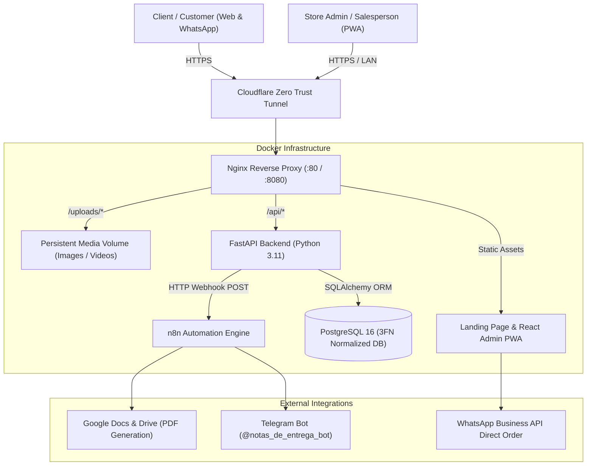

# 💻 ZendroxTech - Enterprise Laptop E-Commerce & POS System

[](https://fastapi.tiangolo.com/)
[](https://react.dev/)
[](https://tailwindcss.com/)
[](https://www.postgresql.org/)
[](https://www.docker.com/)
[](https://n8n.io/)
[](https://www.cloudflare.com/)

> **Full-Stack E-Commerce Catalog, Point of Sale (POS), Accounting Treasury, and Automated Dispatch System** developed for ZendroxTech (retailer of Certified Pre-Owned and Open Box enterprise laptops).

---

## 📌 Project Overview

**ZendroxTech** is a production-grade retail management and customer-facing platform built to eliminate stock discrepancies, speed up sales cycles, automate invoice/delivery note generation, and provide real-time treasury metrics (working capital vs. accumulated profit).

The platform features:
1. **Public E-Commerce Catalog (`/`):** High-conversion landing page with real-time inventory sync, faceted filtering (brand, condition, RAM, price, use-cases), fullscreen image Lightbox, video previews, and one-click WhatsApp pre-filled orders.
2. **Administrative PWA & POS (`/admin`):** Real-time inventory manager with QR/barcode scanner, 3FN hardware selector, interactive multimedia manager (photos and `.mp4` videos), and instant sale checkout.
3. **Double-Entry Treasury & Wallets:** Tracks physical cash (USD/Bs), digital wallets (Zelle, Binance Pay, Zinli, Wally Tech), and segregates working capital reinvestment from gross profits.
4. **Automated Order Dispatch Pipeline (n8n):** Automated webhook that generates PDF delivery notes using Google Docs and dispatches instant customer and team notifications via Telegram.

---

## 🏗️ System Architecture



---

## ✨ Key Features & Technical Highlights

### 1. 3FN Normalized Hardware Engine
Unlike traditional flat-table e-commerce platforms, ZendroxTech normalizes laptop specifications to Third Normal Form (3FN):
* **Atomic catalog tables:** `marca`, `linea`, `procesador`, `grafica_dedicada`, `resolucion`, `pulgada`, `hzs`, and `tipo_pantalla`.
* Ensures data consistency and reusability when creating hundreds of laptop units with identical models or screen panels.

### 2. Multimedia Gallery & Responsive Form Controls
* **Video & Image Lightbox:** Landing page modal supports video streaming (`.mp4`, `.webm`) and image zoom with keyboard navigation (`Esc`, `ArrowLeft`, `ArrowRight`).
* **Zero Horizontal Overflow:** Designed using mobile-first CSS Flexbox & CSS Grid with `min-w-0` and strict viewport bounds.
* **Per-unit Dynamic Tags:** Admin can tag use-case pills (*Gaming*, *Ofimática*, *Arquitectura*, *Estudiantes*, *Diseño 360°*, *Apple*) and customize recommended software per laptop (*AutoCAD, Blender, Premiere, VS Code*).

### 3. POS & Treasury Engine
* Prevents inventory ghost sales with transactional state locks (`disponible`, `reservado`, `vendido`).
* Automated journal entry generation (`transaccion_libro_diario`) for each completed transaction.
* Live balance reconciliation across multiple payment channels (Zelle, Cash, Binance USDT, Zinli, Mobile Pay).

### 4. End-to-End n8n Dispatch Webhook
* Sales recorded on `/admin` trigger a background webhook to `/webhook/notas-entrega`.
* An n8n workflow dynamically injects client name, national ID (cédula), laptop specs, serial number, warranty expiration, and payment reference into an official Google Docs template.
* Generates an encrypted PDF document and immediately alerts the dispatch team via Telegram bot.

---

## 🛠️ Tech Stack

| Layer | Technologies |
| :--- | :--- |
| **Frontend** | React 18, Vite, Tailwind CSS, Lucide Icons, HTML5-QRCode Scanner |
| **Backend** | Python 3.11, FastAPI, Pydantic v2, SQLAlchemy ORM, Uvicorn |
| **Database** | PostgreSQL 16 (Alpine), 3FN Schema, Foreign Key Constraints & Triggers |
| **Server & Proxy** | Nginx (Alpine), HTTP/2, UTF-8 Charset, Dynamic Gzip & Caching |
| **DevOps & Deploy** | Docker Compose, Multi-stage builds, Ubuntu Server 24.04 LTS, Cloudflare Tunnels |
| **Automation** | n8n (Node Automation), Google Docs API, Telegram Bot API |

---

## 🚀 Quickstart (Local Development with Docker)

### Prerequisites
* [Docker Desktop](https://www.docker.com/) (with Docker Compose v2)
* [Git](https://git-scm.com/)

### 1. Clone the repository
```bash
git clone https://github.com/YOUR_USERNAME/zendroxtech-system.git
cd zendroxtech-system
```

### 2. Configure Environment Variables
Copy the example environment file:
```bash
cp .env.example .env
```
*(Optionally adjust `POSTGRES_USER`, `POSTGRES_PASSWORD`, and `APP_PORT`)*

### 3. Start the Platform
```bash
docker compose up -d --build
```

### 4. Access the Applications
* **Public Store:** [http://localhost:8080](http://localhost:8080)
* **Admin Dashboard & POS:** [http://localhost:8080/admin/](http://localhost:8080/admin/)
* **Interactive API Documentation (Swagger):** [http://localhost:8080/docs](http://localhost:8080/docs)

---

## 👨‍💻 Author

**Miguel / ZendroxTech Team**
* Portfolio / LinkedIn: [Tu Perfil de LinkedIn aquí]
* Contact: [contacto@zendroxtech.com]

---

*Licensed under the [MIT License](LICENSE).*
