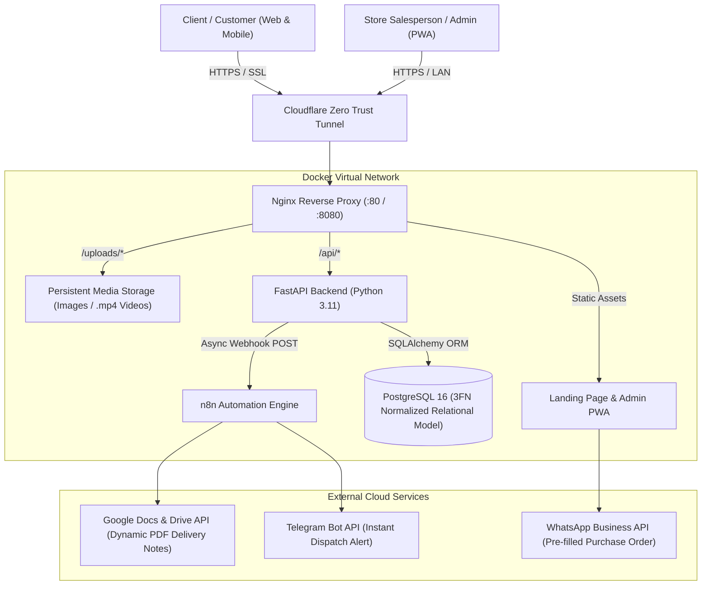

# 💻 ZendroxTech - Enterprise Laptop E-Commerce, POS & Dispatch System

[](https://fastapi.tiangolo.com/)
[](https://react.dev/)
[](https://tailwindcss.com/)
[](https://www.postgresql.org/)
[](https://www.docker.com/)
[](https://n8n.io/)
[](https://www.cloudflare.com/)

> **Full-Stack Commercial Platform:** Public E-Commerce storefront, Administrative Point of Sale (POS), Real-Time Multi-Wallet Treasury, and Asynchronous Dispatch Automation with n8n webhooks.

---

## 📌 Executive Summary

**ZendroxTech** is a production-grade retail management and e-commerce platform engineered for an enterprise laptop distributor (Certified Pre-Owned, Open Box, and New inventory). 

The platform eliminates inventory discrepancies, speeds up customer checkout, automates invoice and warranty note generation, and reconciles multi-currency treasury cash flow in real time.

---

## 🏗️ System Architecture



---

## ✨ Key System Modules

### 1. 🛍️ Customer-Facing Catalog (`/`)
* **Real-time Inventory Synchronization:** Real-time stock status (`disponible`, `reservado`, `vendido`).
* **Faceted Multi-Criteria Filtering:** Filter by brand, processor tier, dedicated GPU, screen size/Hz, aesthetic grade, and price range.
* **Multimedia Lightbox:** Fullscreen dynamic previews supporting both high-res imagery and `.mp4` video demonstration clips.
* **Frictionless Checkout:** Pre-fills customer orders directly into WhatsApp Business with complete hardware specs and SKU references.

### 2. ⚡ Administrative POS & Inventory Manager (`/admin`)
* **Atomic Hardware Spec Engine:** Normalizes hardware configurations to Third Normal Form (3FN: `marca`, `procesador`, `pantalla`, `resolucion`, `hzs`, `grafica`).
* **Camera Barcode & QR Scanner:** Instant lookups of physical units using device cameras without external hardware scanners.
* **Dynamic Software & Persona Tagging:** Custom use-case tagging (*Gaming*, *Architecture/CAD*, *Dev*, *Office*) and compatible software recommendations per laptop.

### 3. 💼 Double-Entry Treasury & Multi-Wallet Manager
* **Multi-Currency Reconciliation:** Live tracking across USD cash, Bolívares (Bs), Zelle, Binance Pay (USDT), Zinli, and Wally Tech.
* **Capital Protection:** Automatic separation between reinvestment working capital (cost of goods) and realized net profit margins.
* **Audit Trail:** Automatic double-entry journal logs (`transaccion_libro_diario`) generated on every confirmed sale.

### 4. 🤖 End-to-End n8n Dispatch Automation Pipeline
* Sales confirmed on `/admin` dispatch an asynchronous webhook payload to the internal n8n engine.
* **Dynamic PDF Compilation:** Populates an official corporate warranty template in Google Docs with customer ID, hardware specs, serial number, and payment verification.
* **Instant Dispatch Notification:** Exports a tamper-proof PDF to Google Drive and notifies dispatch teams via a private Telegram Bot.

---

## 🛠️ Tech Stack & Engineering Highlights

| Domain | Technology | Key Implementation Details |
| :--- | :--- | :--- |
| **Backend API** | Python 3.11, FastAPI, Pydantic v2 | High-performance asynchronous REST endpoints, strict schema validation, dependency injection. |
| **Database** | PostgreSQL 16 (Alpine) | Strict foreign keys, indexing on catalog SKUs, ACID transaction safety on stock checkouts. |
| **Frontend** | Vanilla JS (ES6+), React 18, Tailwind CSS | Zero external UI bloat, mobile-first responsive grid, custom video players. |
| **DevOps & Containers** | Docker & Docker Compose | Multi-container architecture (`web`, `api`, `postgres`), persistent health checks and automated migrations. |
| **Web Server** | Nginx Reverse Proxy | HTTP/2, Gzip compression, client-side caching policies for static assets and media uploads. |
| **Networking & Security** | Cloudflare Zero Trust Tunnels | Public HTTPS exposure without port forwarding, safeguarding private LAN IP addresses. |
| **Automation** | n8n, Google Workspace API, Telegram API | Decoupled event-driven webhook architecture for order fulfillment. |

---

## 🚀 Local Development Setup

### Prerequisites
* [Docker Desktop](https://www.docker.com/) (with Docker Compose v2)
* [Git](https://git-scm.com/)

### 1. Clone the repository
```bash
git clone https://github.com/Miguel-Tafuro/zendroxtech-system.git
cd zendroxtech-system
```

### 2. Configure Environment Variables
Copy the template configuration:
```bash
cp .env.example .env
```
*(The template includes pre-configured local development defaults).*

### 3. Build & Run Containers
```bash
docker compose up -d --build
```

### 4. Verify Services
* **Public Storefront:** `http://localhost:8080`
* **Admin Dashboard & POS:** `http://localhost:8080/admin/`
* **Interactive API Docs (Swagger / OpenAPI):** `http://localhost:8080/docs`

---

## 🔒 Security & Data Privacy

To safeguard business confidentiality while maintaining an open portfolio:
* All database credentials and secret tokens are injected via non-tracked `.env` files.
* Production client information and sales history are strictly excluded via `.gitignore`.
* A sanitized database schema (`base_de_datos_zendroxtech_v2.sql`) with seed data is provided for local reproduction.

---

## 👤 Author & Architecture

**Miguel Tafuro** — *Full-Stack Developer & DevOps Builder*
* **GitHub:** [@Miguel-Tafuro](https://github.com/Miguel-Tafuro)
* **LinkedIn:** [Miguel Tafuro en LinkedIn](https://www.linkedin.com/in/miguel-tafuro/)

---

## 📄 License
Copyright (c) 2026 Miguel Tafuro / ZendroxTech. All rights reserved.  
This repository is published solely for portfolio review and technical evaluation. Unauthorized commercial copying, redistribution, or modification is prohibited.
